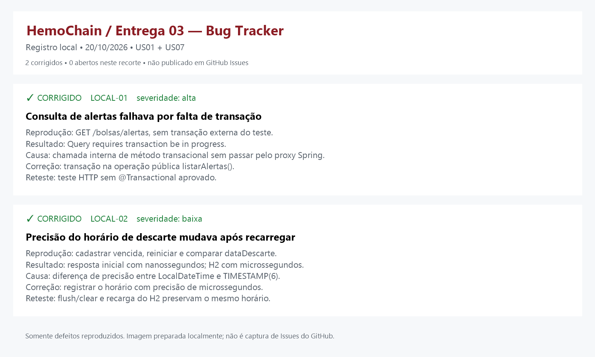

# HemoChain

## Sobre o Projeto
Um Sistema inteligente para gestão da cadeia de hemocomponentes, integrando estoque, compatibilidade, validade e distribuição hospitalar com segurança e eficiência.


## Tecnologias usadas: 
Java 17, Spring Boot 3, PostgreSQL, Docker/Compose e GitHub Actions


## Integrantes:

|Nome|Email|Data de entrada no grupo|
|----|-----|------------------------|
|Mateus Felipe de Souza Oliveira|mfso2@cesar.school|24/08
|Vinicius da Cruz Mendes|vcm5@cesar.school|21/08
|Luiz Felipe Matias Xavier|lfmx@cesar.school|21/08
|Matheus de Assis Carvalho Conolly Silva|maccs@cesar.school|21/08
|Igor Kaua de Souza Siqueira|ikss2@cesar.school|21/08
|Bruno José Cavalcanti Duarte Filho|bjcdf@cesar.school|21/08
|Bruno Sottomayor Martin|bsm4@cesar.school|21/08

## Como rodar o projeto

### Com Docker (recomendado, igual em qualquer maquina)

Requisitos: Docker com Compose v2. Nada de Java ou Maven instalado.

```bash
git clone https://github.com/mateusoliveiraadev/HemoChain.git
cd HemoChain
cp .env.example .env            # Windows (cmd): copy .env.example .env
docker compose up -d --build
docker compose ps               # api e db devem aparecer como "healthy"
curl http://localhost:8080/actuator/health   # {"status":"UP"}
```

Abra http://localhost:8080. Para parar: `docker compose down` (os dados ficam no volume `hemochain-pgdata`). Para apagar tambem os dados: `docker compose down -v`.

Se a porta 8080 estiver ocupada, troque `API_PORT` no `.env`.

### Sem Docker (desenvolvimento local, banco H2 em arquivo)

Requer JDK 17. Na pasta do projeto, execute `./mvnw.cmd spring-boot:run` (Windows) ou `./mvnw spring-boot:run` e abra http://localhost:8080.
Cadastre um usuario sintetico com perfil **Gestor de Hemocentro**, faca login e selecione **Estoque e validade**.
O H2 grava em `./data/hemochain`; mantenha o mesmo diretorio de execucao para reutilizar o banco.
Para compilar, testar e gerar o JAR: `./mvnw.cmd verify`. Encerre a aplicacao antes de reempacotar o JAR no Windows.

---

# Desafio do PI: Container, TDD e Deploy automatizados

URL publica do sistema: **(preencher apos o primeiro deploy, ver `docs/DEPLOY.md`)**

## E1. Container automatizado

| Arquivo | Papel |
|---|---|
| `Dockerfile` | Multi-stage. Estagio 1 (`maven:3.9-eclipse-temurin-17`) compila e roda `mvn verify`, incluindo todos os testes. Estagio 2 (`eclipse-temurin:17-jre-alpine`) leva somente o JAR, roda como usuario sem privilegios e tem `HEALTHCHECK`. |
| `compose.yaml` | API + PostgreSQL 16, volume nomeado, healthcheck nos dois servicos e `depends_on` com `service_healthy`. |
| `.env.example` | Variaveis necessarias. O `.env` real esta no `.gitignore`. |
| `application-prod.properties` | Perfil usado no container: tudo vem de variaveis de ambiente. |

Se um teste falhar, `docker build` falha: nao existe imagem com teste vermelho.

Evidencias: `docs/evidencias/` (prints de `docker compose ps` e da API respondendo).

## E2. TDD

### Story map (Release 1)

| Backbone | Cadastrar estoque | Controlar validade | Requisitar | Alocar | Governar acesso |
|---|---|---|---|---|---|
| **Release 1** | US01 | US07 | US02 | **US03 (parte 1)** | US08 |
| Depois | | | | US03 reserva (T4), US04 rota | US05 temperatura, US06 painel |

### Historias da Release 1 quebradas em tarefas

**US03 (parte 1): hemacias compativeis por FEFO.** Entregue via TDD neste desafio.

| Tarefa | Nivel do teste | Teste | Situacao |
|---|---|---|---|
| T1 Regra ABO/Rh de hemacias | Unitario | `CompatibilidadeServiceTest` | feito |
| T2 Consulta de bolsas disponiveis ordenada por validade | Integracao (com banco) | `BolsaCompativelRepositoryTest` | feito |
| T3 Endpoint `GET /bolsas/compativeis?receptor=` restrito ao gestor | Aceitacao (BDD) | `CompatibilidadeAceitacaoTest` + `docs/bdd/compatibilidade.feature` | feito |
| T4 Reservar a bolsa para uma requisicao (US03 parte 2) | A definir | | pendente |

**US01 (estoque).** T1 validade por componente (unitario `ValidadeServiceTest`); T2 cadastro, duplicidade e campos obrigatorios (aceitacao `EstoqueControllerTest`); T3 persistencia e consulta (integracao, mesmo teste, H2).

**US07 (alertas e descarte).** T1 limiares 5 e 2 dias e fronteiras (unitario `ValidadeServiceTest`); T2 descarte automatico preserva o registro (integracao `EstoqueControllerTest`); T3 vencidas fora da lista de disponiveis (aceitacao).

**US02 e US08.** `RequisicaoServiceTest`, `UsuarioServiceTest`, `AcessoPorPerfilTest`, `HospitalServiceTest`.

### Testes por nivel

| Nivel | Onde | Como rodar |
|---|---|---|
| Unitario | `src/test/java/.../service`, `.../estrutura` | `mvn test` |
| Integracao (com banco) | `BolsaCompativelRepositoryTest` (`@DataJpaTest`), `EstoqueControllerTest` | `mvn test` |
| Aceitacao | `CompatibilidadeAceitacaoTest` (cenarios Gherkin em `docs/bdd/`) | `mvn test` |
| Integracao com PostgreSQL real | job `container` da esteira (sobe o compose e consulta `/actuator/health`) | `docker compose up -d --build --wait` |

Rodar tudo: `./mvnw verify` (ou `docker build .`, que roda os testes no 1o estagio).

### Historico red -> green

Na branch `feature/pi-container-tdd-deploy`:

```
test: compatibilidade ABO/Rh de hemacias com FEFO (RED)     <- so testes; o build falha de proposito
feat: sugere hemacias compativeis (ABO/Rh) por FEFO ... (GREEN)
```

Veja com `git log --oneline`. O "vermelho" aqui e falha de compilacao (as classes ainda nao existiam), que e a forma mais comum do primeiro passo do TDD em Java.

### Quais regras ganharam teste primeiro, e por que

- **Compatibilidade ABO/Rh (US03).** Primeiro teste: um erro nessa tabela pode sugerir sangue incompativel para um paciente. E o maior risco do dominio, por isso a tabela completa dos 8 receptores esta no teste.
- **FEFO e bolsa vencida fora da sugestao.** Evita usar bolsa vencida e reduz descarte.
- **Acesso so do gestor ao endpoint.** Dado sensivel de estoque.

### O que ficou sem teste (e por que)

- As regras de US01, US07, US02 e US08 foram entregues antes deste desafio. Elas tem testes, mas **nao ha historico red -> green delas no Git**.
- Telas estaticas em `src/main/resources/static/*.html` (sem teste automatizado de interface).
- `DadosSinteticosService` e `DadosSinteticosController` (gerador de dados de demonstracao).
- Agendamento por `cron` em horario real (o teste chama o metodo de verificacao diretamente).
- Autenticacao real: o acesso por perfil usa o cabecalho `X-Perfil`, mecanismo didatico das entregas anteriores.

### Testes na esteira

O job `test` roda `mvn verify` a cada push e a cada pull request. Teste vermelho deixa o job vermelho e, com a protecao da `main` ativada (ver `docs/DEPLOY.md`), o merge e bloqueado.

## E3. Deploy automatizado

```
push/PR --> [test: mvn verify] --> [container: compose sobe do zero + health] --> (so na main) [publish: imagem no GHCR] --> [deploy: Render] --> health da URL publica
```

- Ferramenta: **GitHub Actions** (`.github/workflows/ci-cd.yml`).
- Fluxo de branch: **GitHub Flow**. Branches curtas -> pull request -> `main` protegida -> deploy a cada merge.
- Provedor: **Render**, servico por imagem Docker (GHCR) + PostgreSQL gerenciado.
- Segredos: no cofre do GitHub (`RENDER_DEPLOY_HOOK_URL`) e nas variaveis do servico no Render. Nada no repositorio.
- Rollback: workflow **Rollback** (`.github/workflows/rollback.yml`). Informe o SHA de um commit estavel; a imagem dele ja esta no GHCR. Alternativa: botao *Rollback* do proprio Render.
- Passo a passo para configurar tudo (uma unica vez): `docs/DEPLOY.md`.
- Evidencias (execucao vermelha que barrou, verde que publicou, URL no ar): `docs/evidencias/`.

## Decisoes

| Decisao | Escolha | Alternativas | Por que |
|---|---|---|---|
| Imagem base | `eclipse-temurin:17-jre-alpine` (runtime) e `maven:3.9-eclipse-temurin-17` (build) | `eclipse-temurin:17-jdk`, `openjdk` | JRE alpine e menor e tem menos pacotes vulneraveis; a compilacao fica no 1o estagio. Java 17 e o `java.version` do `pom.xml`. |
| Dados | PostgreSQL 16 com volume nomeado `hemochain-pgdata` | H2 em arquivo, MySQL, bind mount | Os dados sobrevivem ao `docker compose down`; PostgreSQL e o que o Render oferece como banco gerenciado, entao dev e producao usam o mesmo motor. H2 segue nos testes por ser rapido. |
| Rede | Rede propria do Compose; a API acessa o banco por `db:5432` | `localhost`, IP fixo | O DNS interno resolve o nome do servico; o banco nao e publicado no host. |
| Testes | Compatibilidade ABO/Rh primeiro | Validade, cadastro | Um erro ali poe um paciente em risco. |
| Fluxo de branch | GitHub Flow | Git Flow, GitLab Flow | Grupo pequeno, uma versao no ar, deploy a cada merge na `main`. |
| CI/CD e deploy | GitHub Actions + Render (imagem do GHCR) | GitLab CI, Railway, Fly.io | O codigo ja esta no GitHub; o Render tem plano gratuito e implanta uma imagem por tag, o que torna o rollback trivial. |
| Segredos | GitHub Secrets e variaveis do Render; `.env` no `.gitignore` | `.env` versionado | Senha de banco e URL do hook nunca entram no Git. `.env.example` so tem valores ficticios. |
| Healthcheck | Actuator `/actuator/health` | Endpoint proprio | Padrao do Spring Boot, sem detalhes expostos. |

## Uso de IA

Declarado conforme a regra da disciplina. A IA rascunhou; o grupo valida e assina.

- **Ferramenta:** Claude (Anthropic), via Claude Code. As entregas anteriores usaram o Codex (ver Entrega 03).
- **O que a IA produziu neste desafio:** `Dockerfile`, `compose.yaml`, `.env.example`, perfil `prod`, workflows do GitHub Actions, `docs/DEPLOY.md`, os testes e a implementacao da compatibilidade ABO/Rh, este texto do README.
- **Prompt principal:** "Com base no repositorio HemoChain e no PDF do Desafio do PI (Container, TDD e Deploy automatizados), faca o que o desafio pede e insira o codigo na pasta do projeto."
- **Limite conhecido:** o ambiente da IA nao conseguia baixar dependencias do Maven nem executar os testes. A regra de compatibilidade foi conferida em Java puro (tabela dos 8 receptores); os testes Spring, o `docker build`, o `docker compose` e a esteira **ainda precisam ser executados pelo grupo**, e a evidencia deve ser registrada em `docs/evidencias/`.
- **Validacao do grupo:** (preencher) revisado por ______ em __/__/____.

---

# 1° Entrega 31/08 (Finalizado):
### 1. Histórias de Usuário
Foram definidas histórias de usuário claras e concisas, contendo descrição da funcionalidade, valor de negócio e critérios de aceitação utilizando BDD.

📄 Documento com as histórias:
https://github.com/mateusoliveiraadev/HemoChain/blob/main/User%20Stories.md

---

### 2. Protótipo Lo-Fi (Figma)
Protótipo de baixa fidelidade do HemoChain, desenvolvido no Figma de forma simples e intuitiva, contemplando as histórias de usuário US01, US02, US05, US06, US07 e US08 nesta primeira versão.

🎨 Acessar protótipo no Figma: https://www.figma.com/proto/9bukhNOO1d01FuRTQAeykD/EmoChain-entrega-01?node-id=3-3&p=f&t=Zfx04rPM9AhRBeHz-0&scaling=min-zoom&content-scaling=fixed&page-id=0%3A1&starting-point-node-id=3%3A3

---

### 3. Screencast do Protótipo

Demonstração da navegação e dos principais fluxos do primeiro protótipo Lo-Fi do HemoChain, contemplando as histórias de usuário US01, US02, US05, US06, US07 e US08.

▶️ Assistir no Youtube: https://youtu.be/oIFck2dseac?is=qg6glqN-vfdn1oYj

---

# 2° Entrega 21/09 (Finalizado):
### 1. Histórias de Usuário
Nesta entrega, implementamos mais 2 histórias ao nosso protótipo: a US08 - Controle de acesso por perfil de usuário e a US02 - Registro de requisição hospitalar. Com isso, ampliamos as funcionalidades do sistema e avançamos na implementação dos principais recursos previstos para o projeto.

📄 Documento com as histórias implementadas:
https://github.com/user-attachments/files/32494810/post-its.md


---

### 2. Issue/Bug Tracker
Este Bug Tracker reúne os principais problemas identificados durante o desenvolvimento, documentando suas causas e respectivas correções.
Também apresenta a classificação dos bugs por tipo, severidade e status, facilitando o acompanhamento e controle das correções.


---

### 3. Screencast do Protótipo 
Neste vídeo, apresentamos uma demonstração do protótipo do HemoChain, mostrando o funcionamento do sistema e suas principais funcionalidades na prática.

▶️ Assistir no Youtube: https://youtu.be/DEyscop7MSQ

---

### 4. Screencast do Código 
Neste vídeo, apresentamos a implementação da aplicação utilizando Spring, explicando sua estrutura e demonstrando as histórias implementadas durante o desenvolvimento do projeto.

▶️ Assistir no Youtube: https://youtu.be/abhnkK4AO8s

---

# Entrega 03 — US01 + US07

### 1. Histórias de Usuário
#### Histórias implementadas — formato POST-IT

**US01 — Cadastro e controle de estoque**

**Como** gestor de estoque, **eu quero** cadastrar, consultar e atualizar bolsas, **para que** eu acompanhe os hemocomponentes disponíveis e sua validade.

Implementado: código único por bolsa, componente, ABO/Rh, volume, coleta, validade automática configurável, status, consulta, edição, validações e persistência H2.

**US07 — Alertas de vencimento e descarte**

**Como** gestor de estoque, **eu quero** receber alertas de vencimento e acompanhar descartes automáticos, **para que** eu priorize o uso e preserve o registro do descarte.

Implementado: limiares configuráveis de 5 e 2 dias, destaque de prioridade, descarte automático, histórico mínimo e verificação na inicialização, agendada e nas consultas. Vencidas não aparecem entre as disponíveis.

[POST-IT completo, funcionalidades e limitações](entrega-03/post-its.md).

#### Configuração didática

Os valores são **exclusivamente acadêmicos, não regras clínicas oficiais**. Em `src/main/resources/application.properties`:

| Componente | Dias após coleta | Propriedade |
|---|---:|---|
| Concentrado de hemácias | 35 | `estoque.validade.hemacias` |
| Plasma | 365 | `estoque.validade.plasma` |
| Plaquetas | 5 | `estoque.validade.plaquetas` |
| Crioprecipitado | 365 | `estoque.validade.crioprecipitado` |

- Alertas: `estoque.alertas.dias=5,2`. Cada limiar pode produzir um alerta distinto para a mesma bolsa.
- Agendamento: `estoque.verificacao.cron=0 0 0 * * *`, à meia-noite no fuso do servidor.
- Validade igual ou anterior ao dia atual implica descarte, sem apagar a bolsa.
- Histórico mínimo na bolsa: data/hora, motivo e responsável `SISTEMA`.
- Coleta histórica é aceita para representar estoque existente; se vencida, a bolsa é descartada automaticamente.
- Uma identificação representa uma bolsa. Volume permitido: 1 a 10.000 mL; coleta futura é rejeitada.

#### Classes, API e testes

Fluxo: `BolsaHemocomponente → BolsaRepository → BolsaService / ValidadeService → BolsaController`.
`AlertaValidade` e seu repositório persistem notificações; `VerificacaoValidadeAgendada` aciona a verificação. A tela `estoque.html` usa o menu existente.

| Método | Endpoint | Finalidade |
|---|---|---|
| POST | `/bolsas` | Cadastrar |
| GET | `/bolsas` | Listar; filtro opcional `status=DISPONIVEL` ou `DESCARTADO` |
| GET | `/bolsas/{id}` | Consultar dados e histórico mínimo do descarte |
| PUT | `/bolsas/{id}` | Editar campos permitidos de bolsa válida |
| GET | `/bolsas/alertas` | Consultar alertas ativos |

Os endpoints exigem `X-Perfil: GESTOR_HEMOCENTRO`, preservando o mecanismo didático da Entrega 02. Não é autenticação robusta. Não há exclusão física, FEFO, reserva, transporte ou rastreabilidade completa.

Testes novos: `EstoqueControllerTest` e `ValidadeServiceTest`, incluindo BDD das duas histórias, datas de fronteira, duplicidades, edição e histórico persistido. A suíte existente de US02/US08, indicadores e estruturas foi preservada.

📄 Documento com as histórias implementadas: [POST-IT — Entrega 03](entrega-03/post-its.md).

---

### 2. Issue/Bug Tracker


Dois defeitos reais reproduzidos e corrigidos: transação da consulta de alertas e precisão do horário de descarte no H2. Esta é uma imagem local, não uma captura nem publicação em GitHub Issues. A atualização externa permanece pendente.

---

### 3. Screencast do Protótipo 
**Vídeo local produzido e validado:** `entrega-03/screencasts/01-demonstracao-sistema.mp4`.

Duração: **80,28 segundos**. Resolução: **1920 × 1080**, MP4/H.264, 25 quadros/s. Sem trilha de áudio, com legendas em português embutidas permanentemente na imagem.

Captura real da aplicação em `localhost:8080`, usando Playwright com o Edge instalado: login de gestor → cadastro e campos obrigatórios → validade automática → consulta e edição → alertas de 5/2 dias → descarte automático e histórico preservado → filtro de disponíveis. Somente dados sintéticos e operações reais.

Preparação sintética com os valores padrão: plaquetas coletadas hoje geram alerta de 5 dias; coletadas há 3 dias geram alerta de 2 dias; coletadas há 5 dias são descartadas. Use códigos diferentes. A inicialização também recupera vencimentos ocorridos durante o desligamento.

▶️ YouTube: publicação pendente; inserir o link público após publicação autorizada.

---

### 4. Screencast do Código 
**Vídeo local produzido e validado:** `entrega-03/screencasts/02-explicacao-codigo.mp4`.

Duração: **112,48 segundos**. Resolução: **1920 × 1080**, MP4/H.264, 25 quadros/s. Sem trilha de áudio, com legendas em português embutidas permanentemente na imagem.

Captura em visualizador local somente leitura, carregando diretamente os arquivos reais do projeto; não é uma gravação do VS Code. Apresenta `BolsaHemocomponente`, `StatusBolsa`, `BolsaRepository`, `BolsaService`, `ValidadeService`, `BolsaController`, `VerificacaoValidadeAgendada` e os testes. As legendas explicam encapsulamento, enum, JPA, regras de negócio, endpoints, agendamento e separação de responsabilidades.

#### Validação e limitações

Revalidação em 20/10/2026: Maven `verify` aprovado com JDK 17; 51 testes sem falhas, incluindo US01, US07 e regressão. Foram executadas 23 verificações HTTP reais, incluindo alertas de 5/2 dias, consultas concorrentes e US02/US08, além de nova verificação de persistência após reinicialização com H2 separado. POM e dependências foram auditados, sem Lombok ou novas bibliotecas.

O bloqueio do Computer Use foi resolvido para esta tarefa por uma alternativa local permitida: Playwright com Edge, sem alterar a implementação ou as dependências do projeto. O fluxo do sistema foi executado e capturado de verdade, com verificação dos resultados e sem erros de JavaScript na tomada final. Os arquivos de código apresentados foram lidos diretamente do projeto em um visualizador identificado como somente leitura.

Os dois MP4 foram decodificados integralmente, reproduzidos no navegador e inspecionados em quadros do início, meio e fim. Duração, resolução e ausência de áudio foram conferidas com FFprobe; as legendas foram verificadas nos quadros finais e a análise não detectou trechos pretos de 0,1 segundo ou mais. Cada vídeo tem 14 blocos de legenda incorporados à imagem, sem depender de arquivo SRT ou faixa de legenda externa.

Os vídeos permanecem para revisão local e são excluídos apenas por `.git/info/exclude`, sem alteração do `.gitignore` público. Ferramentas, scripts e capturas intermediárias estão em `.git/`, fora do versionamento. Nenhum vídeo foi publicado no YouTube.

Código e testes preparados com apoio do Codex. O grupo deve revisar, compreender a implementação e seguir as regras de declaração de uso de IA da disciplina. Nenhum push ou publicação foi realizado; os vídeos permanecem locais para revisão.

▶️ YouTube: publicação pendente; inserir o link público após publicação autorizada.

---


