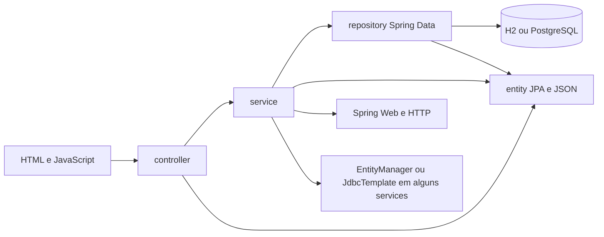
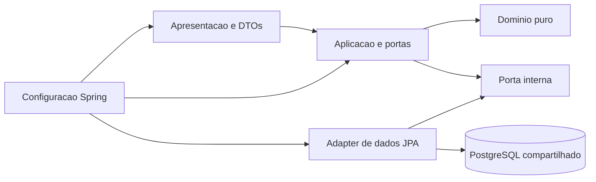

# Auditoria técnica do HemoChain em 24 de novembro de 2026

## 1 Diagnóstico geral e escopo verificado

**O MVP apresenta boa estabilidade nos fluxos exercitados, mas ainda não atende plenamente às exigências de domínio rico e Clean Architecture.** A organização atual é em camadas técnicas globais, com regras predominantemente em services, entidades JPA também usadas como JSON e ausência de portas internas de persistência. A auditoria introduziu medição reproduzível, seis especificações SDD e uma correção pequena e comprovada de invariantes em `EntregaHospitalar`. A modularização e a reserva exclusiva foram planejadas, não implementadas.

Foram inspecionados os 58 arquivos Java de produção, os testes, recursos/configurações, páginas e scripts estáticos relevantes ao fluxo, exercício C da U1, Maven Wrapper/POM, Dockerfile, Compose, workflows, histórias, documentos e histórico Git local. A suíte padrão passou antes de qualquer alteração de produção. Foram executados testes posteriores em H2 e PostgreSQL 16, build Docker em Java 17 e o roteiro existente de interface. Não foi executada a aplicação sobre `data/hemochain` nem sobre o banco preexistente do squad.

| Identificação | Estado observado |
|---|---|
| Branch | `feature/internal-micro-slats` |
| HEAD inicial e preservado | `3c3e506cb55e970d3c5ab246eb4a267e458c458b` |
| Alterações anteriores à auditoria | `entrega-03/bug-tracker.png`, `config/EvolucaoStatusBolsaH2.java`, `config/EvolucaoStatusBolsaH2Test.java` |
| Ambiente local | Windows 11; Maven Wrapper 3.9.14; JVM Temurin 21.0.13; compilação release 17 |
| Stack | Spring Boot 3.3.4, Spring Data JPA, H2 local/testes; PostgreSQL em prod |
| Docker | Inicialmente daemon indisponível; iniciado e validado em projeto isolado `hemochain-auditoria-20261124` |
| Bancos usados nesta auditoria | H2 em memória e banco PostgreSQL exclusivamente sintético criado no volume do projeto isolado |
| Preservação | Hashes dos três arquivos anteriores conferidos; sem push, commit, merge ou deploy |

A baseline representa **HEAD mais as alterações locais preexistentes**, e não uma árvore limpa do commit. O teste H2 adicional já estava presente e integra os 84 testes iniciais; não é autoria desta auditoria. Hashes e inventários estão em [evidências](evidencias/README.md).

### O que existe e o que ainda não existe

| Capacidade | Implementação constatada | Limite |
|---|---|---|
| Estoque | Cadastro/edição, código único normalizado, validade configurável, alertas e descarte | Invariantes concentradas em aplicação/validação HTTP |
| Alocação | Sugestão de hemácias ABO/Rh compatíveis ordenadas por validade/ID | Não reserva nem vincula exclusivamente uma bolsa a uma requisição |
| Requisição | Registro, hospital, urgência/prazo armazenados, listagem e indicadores de demanda | Não implementa fila de emergência, notificação ou parceiros descritos na história extensa |
| Expedição | Atestação manual de entrega, recebimento íntegro/não conforme, uso, estados parciais e prazo | Não há transporte/rota/telemetria; associação hospitalar restrita a hemácias |
| Rastreabilidade | Eventos persistidos, ordenados, transação obrigatória e proteção SQL PostgreSQL | Relações JPA entre responsabilidades e relógio global no evento |
| Acesso | BCrypt e controle didático por cabeçalhos/contexto hospitalar | Login não estabelece identidade autenticada para as chamadas seguintes |
| Indicadores | Algoritmos sequencial/paralelo, projeção e endpoint de demanda | Não equivale à totalidade da US06 de estoque/demanda |
| Estruturas U1 | Lista/fila/pilha Java e equivalentes C acadêmicos | Não são o domínio persistente do MVP; não há ponte com os casos de uso |

## 2 Fragilidades comprovadas de DDD

As referências abaixo apontam para a árvore inspecionada; onde houve alteração, o estado antigo é identificado pelo HEAD inicial ou pelo snapshot preservado. O pacote Java comum `src/main/java/com/hemochain/` foi abreviado na tabela.

| Achado | Evidência concreta | Avaliação e comportamento adequado |
|---|---|---|
| Bolsa pode receber estado/validade arbitrários | `entity/BolsaHemocomponente.java:74` e `:76` | Raiz Bolsa deve proteger criação, correção e transições; setters não são uma linguagem de domínio |
| Descarte protege só repetição | `entity/BolsaHemocomponente.java:82` | `descartar` aceita inclusive bolsa entregue/utilizada; regra disponível + vencida vive em `service/ValidadeService.java:75`. Transferir elegibilidade/transição para a raiz; aplicação mantém busca, locks e evento |
| Recebimento e uso eram simples atribuições | `entity/EntregaHospitalar.java:36` e `:42` no HEAD inicial | Corrigido pontualmente nesta auditoria; nove falhas no primeiro RED e duas no segundo. Ainda faltam outras fronteiras estruturais |
| Requisição essencialmente anêmica | `entity/RequisicaoHospitalar.java:64`, `:70` e `:121` | Construtor/setters não protegem quantidade ou estado; validação de Bean Validation é insuficiente para chamadas diretas |
| Precedência de estados fora do domínio | `service/AtendimentoHospitalarService.java:135` | Política pura deve derivar estados a partir de resumo do atendimento; service carrega dados e coordena a operação |
| Elegibilidade e transições de bolsa no service | `service/AtendimentoHospitalarService.java:44`, `:57`, `:77`, `:82` e `:96` | Bolsa deve controlar entrega/recebimento/bloqueio/uso; aplicação continua verificando hospital, carregando raízes e mantendo transação |
| Compatibilidade é política pura sob anotação Spring | `service/CompatibilidadeService.java:13` e `:16` | A regra pode ser um serviço de domínio ou comportamento do tipo sanguíneo. Não precisa ser forçada para dentro de uma entidade; a tabela já está correta segundo o contrato didático e bem testada |
| Agregados não têm fronteiras explícitas | `entity/EntregaHospitalar.java:12` e `:14`; `entity/EventoBolsa.java:12` | Relações JPA não definem agregados DDD. Propor raízes Bolsa, Requisição e Entrega/Reserva com referências por ID e contratos de aplicação |
| Objetos de valor insuficientes onde há invariantes | Código/volume/datas em `entity/BolsaHemocomponente.java:20`, `:36`, `:41` | Encapsular normalização/faixas/consistência quando proteger regra real. `TipoSanguineo` já é imutável; não criar wrappers vazios para inflar o modelo |
| Acesso tem risco de consistência concorrente | `entity/Usuario.java:27`; `service/UsuarioService.java:28` | Busca antes de salvar não substitui unique de email; eventual correção exige migração e teste concorrente. Cadastro de perfil e identidade precisam de especificação própria |

**Aspectos positivos:** `BolsaHemocomponente.descartar` preserva o primeiro descarte; `EntregaHospitalar.alertar` evita sobrescrever o alerta; `EventoBolsa` não tem setters e bloqueia update/remove via callbacks; `EventoBolsaRepository` não expõe mutação. Há regras e cuidado transacional reais, portanto classificar todas as entidades indistintamente como “só getters/setters” seria incorreto. Hospital pode continuar um cadastro simples; complexidade de domínio deve acompanhar suas responsabilidades.

### Regras críticas verificadas

- **ABO/Rh de hemácias:** `CompatibilidadeService` usa O doador para qualquer ABO, AB receptor de qualquer ABO e Rh positivo somente para receptor positivo. `CompatibilidadeServiceTest.tabelaCompletaDeDoadoresPorReceptor` enumera os oito receptores e cobre os 64 pares por listas esperadas independentes. Não generalizar a política para plasma/plaquetas.
- **FEFO:** consulta `BolsaRepository.java:22` ordena por validade e ID; integração valida duas datas diferentes. Empate por ID ainda não tem teste dedicado. FEFO é sugestão: a atestação manual aceita uma bolsa elegível escolhida pelo gestor e não impõe a primeira da lista.
- **Validade/descarte:** `validade <= hoje` bloqueia a bolsa, conforme `ValidadeService.java:79`; prazos são configuráveis e didáticos. A consulta de compatíveis depende de verificação anterior que pode alterar o estoque; não há seleção/reserva atômica. A consulta isolada do repositório não exclui vencidas por data.
- **Reserva:** inexiste estado/vínculo/comando de reserva. A trava e o unique existentes impedem dupla **entrega**, como verificado em PostgreSQL, mas não comprovam uma funcionalidade ausente.
- **Recebimento:** íntegro exige bolsa entregue e válida; não conforme exige observação e admite registrar chegada de bolsa vencida, bloqueando seu uso. Uso exige recebimento íntegro, validade e unicidade. As guardas da entidade agora complementam as do service.
- **Prazo e status:** atraso é estritamente posterior ao prazo, não no limite exato; alerta único permanece após recebimento tardio, enquanto a pendência ativa é resolvida. Estados parciais e precedência pendência/não conformidade estão implementados; falta uma tabela unitária completa de combinações.

## 3 Arquitetura atual e proposta

Há separação reconhecível entre controllers, services e repositories, com injeção de construtor e ausência de acesso direto a repositórios nos controllers inspecionados. Entretanto, isso ainda é uma arquitetura em camadas convencional, não Clean Architecture.



Acoplamentos específicos:

1. `BolsaHemocomponente.java:6` importa Jackson e `:7` JPA; `RequisicaoHospitalar.java:32` inclui uma entrada de formulário transitória. DTO, domínio e persistência compartilham identidade de classe.
2. `BolsaService.java:5`/`:8`, `RequisicaoService.java:5`/`:7` e `AtendimentoHospitalarService.java:6`/`:9` importam HTTP/ResponseStatusException. A camada de aplicação sabe como o erro será entregue pela Web.
3. `RastreabilidadeService.java:15` conhece EntityManager; `DadosSinteticosService.java:40` conhece JdbcTemplate. O gerador é infraestrutura de apoio, não uma regra de negócio a mover para entidade.
4. `RequisicaoController.java:39` e `:51` decidem filtragem/autorização hospitalar; invocar `RequisicaoService` diretamente não aplica a mesma política. Validação do formato HTTP pertence ao controller; autorização do caso de uso deve sobreviver fora dele.
5. `AtendimentoHospitalarService.java:15` a `:19` atravessa Requisição, Estoque e Rastreabilidade por seus repositories/modelos concretos. É uma orquestração necessária, mas seus contratos entre módulos não estão definidos.
6. Serialização de entidades e Open EntityManager in View habilitado por padrão mantêm dependência implícita da Web com persistência. Desligá-lo agora, sem DTOs/consultas adequados, pode quebrar a API; fica no plano.

A estrutura sugerida pelo usuário é adequada como destino, com estes ajustes:

```text
com.hemochain
  estoque, alocacao, requisicao, expedicao, rastreabilidade, acesso
    apresentacao       controllers, DTOs e conversao de erros HTTP
    negocio
      aplicacao        casos de uso, comandos, resultados, contratos e portas
      dominio          raizes, invariantes, valores e politicas puras
    dados              adapters JPA, consultas, modelos persistentes e mappers
  compartilhado        somente vocabulario/valores realmente estaveis
  configuracao         composicao Spring e ligacao dos adapters
```



**O diagrama é proposto; esses pacotes ainda não existem.** A primeira migração deve comprovar a regra de dependência numa fatia de Estoque/Alocação, em vez de renomear pastas. Spring pode permanecer no adapter/composição de transações da aplicação, mas o núcleo de domínio não precisa dele. Portas são definidas pelas necessidades do caso de uso, e adapters as implementam.

### Contextos e propriedade das regras

| Contexto proposto | Responsabilidade e raiz | Comunicação no monolito |
|---|---|---|
| Estoque | Bolsa, validade e ciclo de disponibilidade/descarte | Expõe consulta/elegibilidade e comandos, sem compartilhar entidade JPA com outro domínio |
| Alocação | Compatibilidade, política FEFO e futura Reserva | Caso de uso coordena Requisição/Estoque por portas; banco protege exclusividade |
| Requisição | Demanda, quantidade e situação derivada | Hospital como cadastro associado a Requisição inicialmente; extrair cadastro institucional só se o domínio justificar |
| Expedição | Atestação de Entrega, recebimento, uso e prazo | Não representa transporte completo; consulta a autorização e coordena estado da bolsa |
| Rastreabilidade | Fatos imutáveis por IDs e origem | Porta síncrona na mesma transação; não introduzir fila assíncrona que quebre atomicidade |
| Acesso | Identidade, perfil e vínculo hospitalar | Contexto explícito de aplicação; autenticação real depende de lote próprio |
| Compartilhado | Tipos comuns estáveis e identificadores necessários | Não transformar em pacote de todos os services, entidades ou utilitários |

Um processo e uma base compartilhada continuam permitidos. A divisão de pacotes não exige seis módulos Maven nem microsserviços. Também não exige criar uma “raiz Estoque” contendo todas as bolsas: isso ampliaria artificialmente o agregado e a contenção. IDs e restrições transacionais delimitam a consistência necessária.

### ArchUnit

É recomendado para o recorte estrutural aprovado: domínio independente de Spring/JPA/Jackson, apresentação sem repository, adapters implementando portas, acesso entre módulos por contratos e ausência de ciclos. Nenhuma dependência/regra ArchUnit foi adicionada nesta execução. Aplicar a regra pura globalmente hoje falharia de forma legítima; selecioná-la apenas em pacotes inexistentes produziria um verde vazio. O plano R08 prevê classes concretas, seleção não vazia e teste da detecção de violação. Essa aplicação é compatível com as capacidades descritas no [guia oficial do ArchUnit](https://www.archunit.org/userguide/html/000_Index.html).

## 4 Baseline, cobertura e lacunas de testes

| Medida comparável | Antes | Depois |
|---|---:|---:|
| Suíte padrão executada/aprovada | 84/84 | 98/98 |
| Falhas / erros / ignorados | 0 / 0 / 0 | 0 / 0 / 0 |
| Linhas | 705/833 = 84,63% | 719/847 = 84,89% |
| Branches | 207/273 = 75,82% | 227/293 = 77,47% |
| Métodos | 247/277 = 89,17% | 247/277 = 89,17% |

As duas medições usam JaCoCo 0.8.14, JVM 21, release 17, mesma suíte padrão H2/MockMvc; a primeira foi coletada por goals explícitos sem modificar o POM/código. O arquivo de execução foi criado durante essa medição, sem cobertura anterior acumulada. O novo POM usa `append=false` para evitar acumulação entre execuções. Não há exclusões de produção para melhorar o resultado. JaCoCo conta execução de bytecode; seus contadores de linhas, branches e métodos têm significados distintos, conforme a [documentação oficial](https://www.jacoco.org/jacoco/trunk/doc/counters.html).

Na árvore inicial havia 19 arquivos Java de teste: 18 suites executadas por padrão e `HistoricoPostgresIT` com quatro testes executados apenas pelo perfil próprio. Após a correção há 20 arquivos, 19 suites padrão e a mesma IT. Invocações parametrizadas contam individualmente. Os quatro testes PostgreSQL não foram “ignorados” no Surefire; não são selecionados pela suíte padrão. Sua baseline anterior à refatoração **não foi executada**; o resultado posterior foi 17 cenários já existentes de aceitação/rollback + 4 IT, todos aprovados.

[Cobertura completa](cobertura.md) contém linhas/branches/métodos por pacote real e por contexto analítico, além do inventário de cada suite. Não há bounded contexts fisicamente separados ainda; a atribuição por classe está explicitada no script e no JSON. Um grupo Alocação com 100% significa cobertura da política ABO/Rh existente, não da reserva ausente. Interfaces Spring Data têm denominador N/A; seus contratos são exercitados por integração.

Lacunas de maior valor:

- A raiz Bolsa ainda permite transições inválidas via setter e descarte direto. Os caminhos HTTP estão protegidos; isso não protege outro chamador.
- Empate FEFO, fronteira exata do vencimento na sugestão e atomicidade entre seleção e reserva não estão demonstrados por um teste da futura reserva. Não atribuir zero porcentual a uma classe que ainda não existe; registrar funcionalidade ausente.
- A política de estados não tem tabela unitária de todas as combinações, apesar da aceitação de parcial/total e precedência atual.
- `AtendimentoHospitalarService` tinha 76/90 branches cobertos na baseline; `BolsaService`, 7/10; `ValidadeService`, 24/31. Cobrir erros e decisões restantes é mais valioso que getters.
- Controladores de indicadores e dados sintéticos não têm caminhos funcionais exercitados na baseline; o gerador tem apenas 4/46 linhas cobertas por construção. Há risco de entrada inválida de quantidade mínima de hospitais. A proposta é testar/especificar, não inventar a regra de cadastro de hospitais.
- O método público de indicadores, limites de threads/filtro e tratamento de falha/interrupção não são cobertos pelos testes sequencial/paralelo, que instanciam o service com repository nulo.
- Autorização por cabeçalho é testada, mas não representa teste de autenticação real. Concorrência de email não está coberta nem protegida por unique.

**Fragilidade dos testes:** `HospitalServiceTest.java:34` e `RequisicaoServiceTest.java:72` usam contagens mínimas que passam mesmo com dados extras; testes transacionais de cadastro podem esconder falhas de commit; há reflexão para configurar a validade e H2 com nome compartilhado/DB_CLOSE_DELAY. Datas globais e agendadores habilitados merecem isolamento. Em contrapartida, `AtendimentoHospitalarAceitacaoTest.java:23` e testes de rollback usam commits reais e os IT concorrentes usam barreira/timeout. São evidências fortes que devem ser preservadas.

As metas e sua justificativa estão no [plano](plano-refatoracao.md): foco em transições e matriz, novo núcleo ≥95% linhas/≥90% branches, aplicação crítica ≥90%/≥85%, objetivo global moderado de ≥85% linhas/≥80% branches/≥90% métodos para 01/12. Os números globais finais desta auditoria ainda não alcançam essas metas; não foi criado gate artificial para escondê-lo.

## 5 Especificações SDD e rastreabilidade

[Especificações completas](especificacoes.md), preparadas antes das mudanças correspondentes:

| Especificação | Escopo | Estado |
|---|---|---|
| SDD-01 | Recebimento e uso com invariantes locais | Implementada; sete critérios, dois ciclos TDD |
| SDD-02 | Reserva exclusiva compatível por FEFO | Proposta; decisões de contrato, vínculo e ciclo da reserva pendentes |
| SDD-03 | Bolsa, validade e descarte | Refatoração proposta |
| SDD-04 | Requisição e precedência de estados | Refatoração proposta |
| SDD-05 | Rastreabilidade e prazo | Refatoração proposta |
| SDD-06 | Acesso e fronteiras arquiteturais | Refatoração proposta; autenticação nova separada |

Cada uma inclui contexto/problema, esperado, regras/invariantes, aceite testável, Gherkin, exceções, estratégia de testes e conclusão. A matriz final conecta requisito → especificação → método de teste → implementação → evidência, distinguindo testes existentes de nomes propostos. Os `.feature` anteriores são especificações mapeadas manualmente para JUnit/MockMvc; não há Cucumber ou geração automática de testes. SDD passa a existir como processo nesta correção; a mera existência de Gherkin antigo não prova que toda implementação histórica foi guiada por especificações.

## 6 Alterações executadas e exemplos de código

Foram alterados quatro arquivos preexistentes por esta auditoria: `EntregaHospitalar.java`, `pom.xml`, `.github/workflows/ci-cd.yml` e `README.md`; foram acrescentados o teste de entidade, script de métricas e documentos/evidências. O README recebeu os links/métricas datados e correções da classificação dos testes PostgreSQL e de interface. Nenhuma tela, contrato REST, enum, schema ou regra de compatibilidade foi alterada.

Antes, em `EntregaHospitalar` no HEAD inicial:

```java
public void receber(CondicaoRecebimento condicao, String observacao, Instant agora, String origem) {
    this.condicao = condicao;
    this.observacao = observacao;
    this.recebidaEm = agora;
    this.origemRecebimento = origem;
}
public void utilizar(Instant agora, String origem) { utilizadaEm = agora; origemUtilizacao = origem; }
```

Depois, a transição de uso em `EntregaHospitalar.java:54`:

```java
public void utilizar(Instant agora, String origem) {
    if (recebidaEm == null || condicao != CondicaoRecebimento.INTEGRA || utilizadaEm != null) {
        throw new IllegalStateException("Uso exige recebimento integro e ainda nao utilizado.");
    }
    if (agora == null) {
        throw new IllegalArgumentException("Informe o instante da utilizacao.");
    }
    utilizadaEm = agora;
    origemUtilizacao = origem;
}
```

O recebimento agora verifica repetição, condição, observação de não conformidade e instante antes das atribuições. O instante não nulo é necessário porque a ausência de `recebidaEm`/`utilizadaEm` representa a ausência do fato. Não foram criadas restrições novas de ordenação temporal. Uma tentativa rejeitada não deixa campos parcialmente modificados.

O service conserva autorização, verificações envolvendo outras raízes, locks, validade, atualização da bolsa/requisição, transação e evento. Mantém também as guardas HTTP existentes, para não converter erros esperados de 400/409 em exceções internas não mapeadas. A remoção dessa duplicação depende do lote estrutural com mapper de erros. Isso fortalece comportamento do domínio sem mover mecanicamente toda a orquestração para entidades.

Limites da correção: a classe ainda é JPA; construtor, origem e alertas ainda não estão integralmente encapsulados; Bolsa/Requisição continuam com setters. Não declarar o domínio inteiro rico por causa desta alteração.

JaCoCo foi adicionado ao `verify`; o perfil `postgres-it` gera relatório Failsafe separado. A CI publica `target/site/jacoco` e `target/site/jacoco-it` junto dos testes. Essa configuração segue a integração Maven documentada pelo [JaCoCo](https://www.jacoco.org/jacoco/trunk/doc/maven.html). Não houve upgrade do Spring ou alteração da seleção dos testes.

## 7 Evidências de TDD

### Histórico anterior

`git show --stat 9fff19a` mostra somente testes de compatibilidade/repository/aceitação e Gherkin; `CompatibilidadeService` não existe nesse commit. `ae719f3` introduz a implementação e as consultas/endpoint. Essa sequência sustenta evidência histórica localizada de teste antes da implementação, com RED de compilação. Não reexecutamos esses commits e não há prova equivalente para todo o projeto. O commit `87ced5e` contém conjuntamente entidade e aceitação de US09/US10; sua mensagem não prova a ordem interna de desenvolvimento.

### Ciclos observados nesta auditoria

| Etapa | Execução observada | Resultado |
|---|---|---|
| SDD-01 inicial | Especificação e hashes antes de mudar a entidade | Regras e aceite definidos |
| RED 1 | Novos testes chamam os métodos existentes sem guardas | 12 executados, 9 falhas de asserção, 0 erros/ignorados |
| GREEN 1 | Guardas de condição/transição/observação | 12/12; suíte completa intermediária 96/96 |
| Revisão | Detectada possibilidade de instante nulo contornar marca de ocorrência | SDD-01 ampliada antes do teste adicional |
| RED 2 | Dois novos casos de instante ausente | 14 executados, 2 falhas de asserção, 0 erros/ignorados |
| GREEN 2 | Guarda de instante antes da mutação | 14/14; suíte final 98/98 |
| REFACTOR e regressão | Revisão da separação de guardas e orquestração; nenhuma extração artificial necessária | API/rollback, PostgreSQL, Docker e fluxo UI preservados |

Os REDs foram produzidos pelo comportamento ausente, não por erro de compilador, ambiente ou teste desabilitado. A fase REFACTOR foi uma revisão da estrutura com regressão; não houve uma terceira mudança cosmética para fabricar um commit “REFACTOR”. A correção continua local e não commitada; logs/XMLs/hashes registram a ordem observada, sem alegar um histórico Git novo inexistente.

Os métodos `receber` e `utilizar` terminaram com 100% de linhas/branches; a entidade completa tem 42/42 linhas e 21/22 branches (o caminho de repetição de `alertar` não foi exercitado diretamente). **Na baseline a entidade já tinha 28/28 linhas**, mas aceitava as violações do primeiro RED: cobertura de execução não prova invariantes.

## 8 Validação final e CI/CD

| Verificação | Resultado desta auditoria | Limite da conclusão |
|---|---|---|
| Compilação e pacote Maven | `verify` aprovado, release 17 | JVM local é 21 |
| Suíte padrão | 98 testes; 0 falhas/erros/ignorados | Integração padrão usa H2/MockMvc |
| PostgreSQL 16 real | 17 cenários de aceitação/rollback + 4 IT aprovados | Execução selecionada, não cobertura global do produto |
| Cobertura | XMLs antes/depois e relatórios PostgreSQL separados | Métricas de JVM 21 não são misturadas com o build Linux Java 17 |
| Build Docker | 98 testes aprovados no estágio Maven Java 17 | Não houve publicação da imagem |
| Compose | Configuração válida e API/DB saudáveis em projeto isolado | Sem alteração do Compose versionado |
| Interface | `scripts/entrega04-ui.cjs` aprovado, zero erros JavaScript | Fluxo principal desktop; sem repetir toda matriz visual/tablet/mobile |
| Pendência temporal | Coberta pela aceitação com Clock e PostgreSQL | Roteiro UI desta auditoria não ativou o modo de atraso PT5S |
| Persistência | Recriação de containers sem remover volume, histórico/entrega comparados | Apenas dados sintéticos do projeto isolado |
| CI/CD | YAMLs analisados; comandos centrais equivalentes executados localmente | Workflow remoto da alteração ainda não executado; sem push autorizado |
| Git/local | `git diff --check` sem erros de whitespace; hashes anteriores preservados | Avisos de conversão LF/CRLF do Git não são falhas de teste |
| Exercício C | Fonte/Makefile inspecionados | Sem compilador C no PATH; asserts C não executados e fora da cobertura Java |

A esteira existente possui ordem test → PostgreSQL → container → publish → deploy; publish/deploy ficam restritos a push na main. O rollback é um workflow manual. Não há inspeção de branch protection/credenciais remotas nesta execução, e o YAML sozinho não comprova configuração no GitHub. A configuração registra relatórios, mas ainda não impõe limiar JaCoCo ou regras ArchUnit. Health após deploy verifica saúde, não identidade do SHA publicado. Tags de imagens/actions são mutáveis; pinagem por digest/SHA é uma melhoria posterior.

O log PostgreSQL contém erro SQL esperado quando o teste tenta remover bolsa referenciada por evento. A exceção está dentro de `assertThrows` e a suite termina verde; não foi ignorada uma falha real. Uma execução Maven final foi interrompida pela reinicialização do servidor de ferramentas e reexecutada integralmente; o log parcial foi preservado em `target/auditoria/`, e não contado como aprovação.

Ao encerrar a validação, somente os serviços do projeto `hemochain-auditoria-20261124` foram parados. Containers e volume sintético foram preservados para reprodução; os containers preexistentes do squad não foram parados. O estado saudável da tabela acima corresponde à execução registrada antes dessa parada.

## 9 Plano concreto até 01/12

O [plano de refatoração](plano-refatoracao.md) detalha, por tarefa R00–R11, problema, classe/caminho/linha, situação atual/proposta, justificativa, risco, testes, prioridade e aceite, com distinção entre existente, refatoração e novo.

Até 01/12, após aprovação, priorizar uma fatia Estoque/Alocação com domínio puro, portas/adapters, contratos preservados, ArchUnit sobre classes reais e núcleo de reserva FEFO. A reserva persistente depende das decisões de contrato/ciclo, migrações e concorrência PostgreSQL; não pode ser acrescentada como se fosse mero rearranjo de pacotes. Precedência de requisição, adoção integral de migrações versionadas, autenticação e migração de todos os contextos ficam em lotes próprios.

O cronograma começa com revisão em 25/11, núcleo e fronteiras em 25–26/11, reserva em 27–29/11 e congelamento/evidências em 30/11. A capacidade do squad não foi informada; 21–29 h para a fatia estrutural/reserva é estimativa condicionada. Se integração/contrato não forem aprovados a tempo, demonstrar a parte efetivamente concluída e declarar a reserva persistente pendente.

## 10 Documentação acadêmica, pendências e riscos

`docs/arquitetura/` não existe no checkout examinado. Não foram localizados diagramas de arquitetura, planilha de orçamento ou ADRs nesse caminho, nem histórico local desse diretório. Há README com seção de decisões operacionais, documentação de deploy, histórias/BDD e evidências das entregas; isso não substitui os artefatos exigidos. `User Stories 2° Entrega.md` tem dois bytes e nenhum planejamento útil. Os documentos U2 e a decisão formal da Parte 3 não foram fornecidos/localizados, portanto não foi possível verificar seu conteúdo ou alegar conformidade com eles. O monolito modular foi respeitado pela restrição explícita da solicitação.

Revisões necessárias:

1. Vincular a baseline atual, cobertura por pacote/contexto e metas ao planejamento U2 quando localizado; manter a história âncora como proposta até reconciliar a fonte original.
2. Corrigir as seções antigas do README: a tabela anterior atribuía integração PostgreSQL apenas ao smoke Compose e dizia que não havia teste automatizado de UI, embora existam perfil IT e scripts. Manter contagens históricas datadas; não substituir 83/84 de evidências anteriores por números de outra execução.
3. Registrar no story map que US03 parte 1 está entregue e reserva exclusiva continua pendente; separar indicador de demanda implementado do painel completo da US06.
4. Criar diagramas *atual* e *proposto* em `docs/arquitetura/` conforme o formato acadêmico; registrar estados/locks/atomicidade e diferença entre atestação e transporte. Os diagramas desta auditoria são uma proposta técnica, não anexos preexistentes da Parte 3.
5. Recuperar/criar ADRs com estado, contexto, alternativas e consequências; confirmar a decisão do monolito, limites dos contextos, consistência da reserva, tempo e evolução do banco.
6. Produzir orçamento somente com premissas, quantidades, preços/fontes/datas e fórmulas verificáveis. Nenhuma planilha ou valor de custo foi inventado nesta auditoria.
7. Atualizar roteiros/screencasts para explicar um exemplo antes/depois, os dois REDs observados e as limitações remanescentes. Há MP4/SRT locais em `Entrega 04/`; publicação e conteúdo audiovisual não foram homologados aqui.

Riscos remanescentes de maior impacto: modelo anêmico fora da correção, acoplamento JPA/JSON, ausência da reserva, autenticação declarada pelo cliente, DDL no startup herdando `ddl-auto=update`, dependência de data local/UTC e evidência arquitetural incompleta. O sistema foi validado como protótipo acadêmico com dados sintéticos; os testes não sustentam afirmar adequação clínica ou autenticação de produção.

## 11 Veredito simulado do professor

Escala adotada: 0 = ausente; 5 = aplicação parcial com lacunas relevantes; 8 = evidência substancial, ainda incompleta; 10 = exigência integral demonstrada e reproduzível. Notas avaliam o estado **após esta auditoria**, sem atribuir como entregue o que está só no plano.

| Dimensão | Nota / 10 | Fundamentação |
|---|---:|---|
| DDD e domínio rico | **4,0** | Recebimento/uso protegidos com evidência real; Bolsa/Requisição seguem com setters e regras no service; agregados e fronteiras ainda implícitos |
| Clean Architecture | **2,5** | DTO/domínio/JPA misturados, aplicação acoplada a Web e persistência; portas/independência apenas propostas |
| Arquitetura em camadas | **6,0** | Controllers/services/repositories claros e injeção adequada, mas autorização espalhada e limites transversais frágeis |
| Planejamento de refatoração | **8,0** | Arquivos/linhas, prioridades, riscos, testes, aceite, sequência e contingência concretos; U2/ADR original e capacidade do squad não verificadas |
| TDD e cobertura | **8,0** | Baseline real, dois REDs comportamentais, 98 testes verdes, PostgreSQL/Docker e métricas; não há prova de TDD global nem gate de cobertura |
| SDD | **7,0** | Seis specs, aceite/Gherkin/exceções/testes e matriz; somente SDD-01 percorreu implementação, âncora U2 ainda precisa de reconciliação/aprovação |
| Estabilidade do sistema | **8,0** | Maven, PostgreSQL, concorrência, rollback, Docker, UI e persistência exercitados; configuração remota, todos os fluxos visuais e dívida de domínio ainda limitam a conclusão |

**Parecer:** a entrega tem base funcional e de testes para evoluir, mas apresentar a árvore atual como DDD rico ou Clean Architecture seria tecnicamente incorreto. A demonstração de 01/12 deve mostrar a fatia aprovada e implementada, sua especificação e seu RED/GREEN, distinguindo claramente o plano restante. A próxima autorização deve cobrir R02/R03/R08; R04 exige uma decisão separada sobre funcionalidade, banco e contrato.
