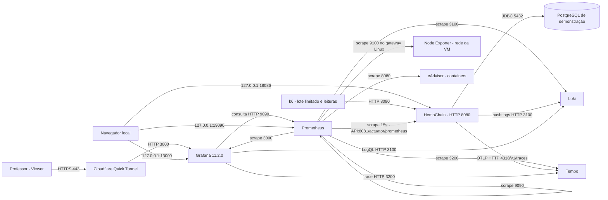

# Arquitetura da demonstração RSD

O projeto Compose `hemochain-observabilidade` possui rede e volumes próprios. O `compose.yaml` de trabalho e o deploy Render não fazem parte desta demonstração. As portas publicadas usam loopback do Windows; somente o Grafana é encaminhado pelo Quick Tunnel autorizado em 27/11/2026.

O Actuator, PostgreSQL, Loki, Tempo e cAdvisor não têm porta publicada no Windows. A rede Docker compartilhada permite comunicação entre seus participantes; não se afirma exclusividade do Prometheus no acesso ao Actuator. O acesso ao daemon Docker é administrativo.

Node Exporter utiliza o namespace de rede da VM Linux e escuta no gateway interno `172.17.0.1:9100` nesta instalação. O valor é ajustável por `OBS_VM_GATEWAY`. CPU, memória, disco, rede e load correspondem à VM Linux do Docker Desktop/WSL2, não ao Windows físico. O disco dos dados Docker é identificado por mounts Linux, incluindo `/var/lib`.

O cAdvisor 0.55.1 é usado porque a versão original 0.49.1 não identificou os containers com o armazenamento overlayfs/containerd instalado. Os privilégios e mounts do patch foram conservados para a coleta funcionar. O Prometheus descarta métricas de containers de outros projetos e o exporter conserva apenas labels de projeto e serviço.

Persistência em volumes exclusivos: PostgreSQL, Prometheus, Grafana, Loki e Tempo. Retenções configuradas: métricas 3 dias/512 MB de blocos, logs 72h e traces 48h. Logs dos containers têm rotação de 5 MB × 2. Os limites de retenção não equivalem a quotas rígidas do filesystem.

Instrumentação: span HTTP automático, span `registrar-entrega`, spans JDBC e logs com `traceId`/`spanId`. A contagem e o timer de negócio medem tentativas do método; não atestam commit. O domínio não recebeu dependências de observabilidade.
